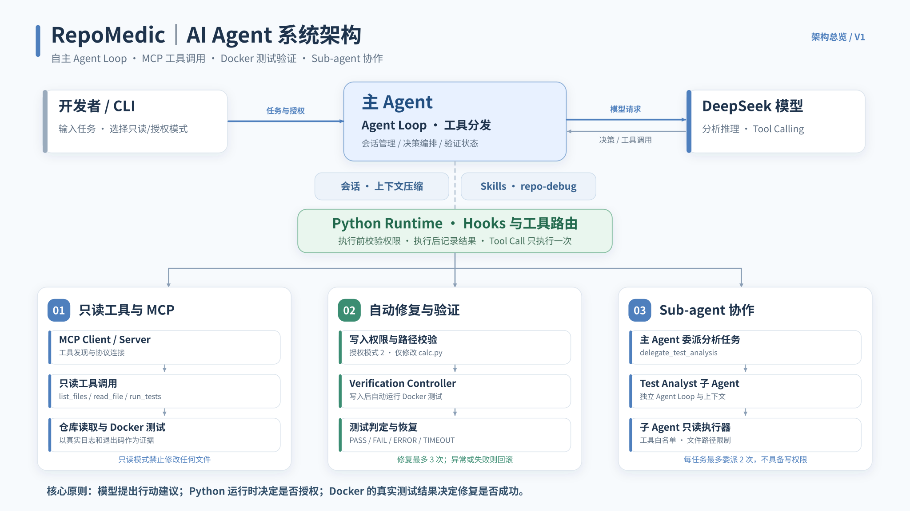
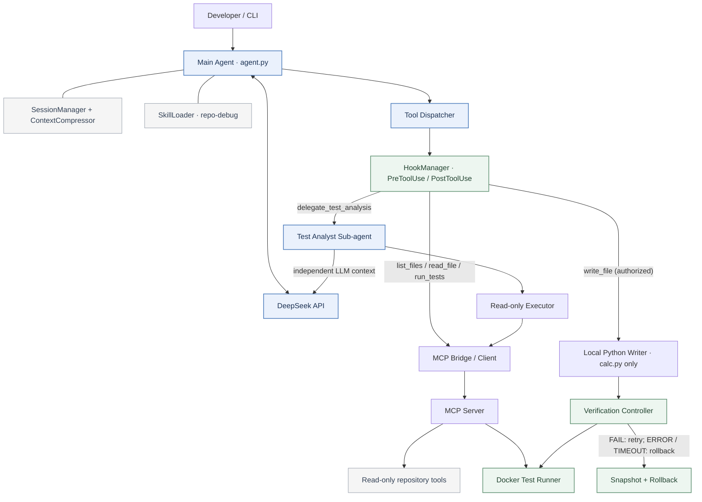

# RepoMedic 系统架构

本文档描述 RepoMedic 当前代码中的主要组件、执行路径与安全边界，重点区分 **LLM 提议的动作**和 **Python Runtime 实际允许的动作**。

## 架构总览



可编辑 Mermaid 源文件见 [`architecture.mmd`](architecture.mmd)。当前随附 SVG / PNG 图片由 [`architecture.dot`](architecture.dot) 使用 Graphviz 渲染；修改 Mermaid 并不会自动更新 SVG / PNG。



## 1. Main Agent：工具编排与模型循环

入口是 `agent.py` 中的 `run_agent()`。用户指定权限模式后：

1. `SessionManager` 加载或创建会话，`ContextManager` 与 `ContextCompressor` 选择本轮发送的上下文。
2. `SkillLoader` 根据任务匹配 `repo-debug` 等 Skill，将工作流程文本加入系统上下文。Skill 文本**不修改**工具实际权限。
3. Agent 调用 DeepSeek API（兼容 OpenAI Chat Completions），获得普通回答或结构化 Tool Calls。
4. 同一批模型工具调用先保存为 assistant 消息，再逐一执行，每个 `tool_call_id` 都回写一个 tool 消息。
5. `HOOKS.guard()` 包住实际分发；正常完成触发 Pre/Post 日志，拒绝或异常反馈给模型。

> 不存在“DeepSeek 直接修改磁盘”的路径。模型只提出工具调用，是否执行取决于 Runtime。

## 2. 只读路径：MCP 与本地工具

对 `list_files`、`read_file`、`run_tests`，在启动 `agent.py` 的正常 MCP 模式下：

```text
Main Agent → HookManager → MCP Bridge/Client → MCP Server
                                            ├── list_files
                                            ├── read_file
                                            └── run_tests → Docker Test Runner
```

在单元测试和 Benchmark V1 模式下，`run_agent()` 也能使用本地 `run_tool()`。这两个执行入口不能误写成“Benchmark V1 也测过 MCP”：**Benchmark V1 当前绕过 MCP Server**。

## 3. 写入路径：Verification Controller

只有用户选择授权模式，主 Agent 才向模型暴露 `write_file`；Runtime 和 Hook 仍二次检查。写入限制到 `demo_repo/calc.py`。

```text
write_file request
    ↓
PreToolUse + 权限/次数检查
    ↓
任务开始前 calc.py 快照 + 独立备份
    ↓
原子写入 calc.py
    ↓
执行 Docker 单元测试，验证结构化结果
    ├── PASS          → 可确认当前修改通过现有测试
    ├── FAIL          → 最多 3 次修改尝试，仍失败则回滚
    ├── ERROR         → 环境异常，停止并回滚
    └── TIMEOUT       → 测试超时，停止并回滚
```

测试 `PASS` 必须具有相互一致的 `status="PASS"`、`passed=True`、`returncode=0` 和正数 `test_count`。仅靠模型的自然语言“修好了”不能达成验证成功。

**范围提醒：** Docker 隔离的是测试执行；主 Agent、会话管理、写入工具和其他进程不因此自动受 Docker 沙箱保护。

## 4. 子 Agent 委派路径

主 Agent 通过 `delegate_test_analysis` 启动 `TestAnalystSubAgent`：

- 使用自己的 `messages` 上下文与 DeepSeek 工具循环。
- 仅暴露 `list_files`、`read_file`、`run_tests`。
- `read_file` 限制为 `calc.py` 和 `test_calc.py`；全部工具经只读 executor 和 Hook。
- 最多 **4** 个模型步骤、**8** 次工具调用；每次模型请求设置 **20 秒**超时。
- 主 Agent 每个用户任务最多委派 **2** 次，防止重复启动。
- 子 Agent 输出分析结果，不自动拥有写入权，也不替代主 Agent 的最终验证证据。

## 5. Session、Skill、Hook 的不同职责

| 机制 | 功能 | 是否具有最终写入决策权 |
| --- | --- | --- |
| Session / Context | 恢复对话、压缩历史 | 否 |
| Skill | 向模型注入任务步骤与经验 | 否 |
| PreToolUse / Runtime | 拦截工具调用和限制路径、模式 | **是，按 Python 规则** |
| PostToolUse | 记录成功或失败 | 否 |
| OnVerificationFail | 记录 `FAIL / ERROR / TIMEOUT` 事件 | 否 |
| Verification Controller | 依据真实测试结果决定修复继续、成功或回滚 | **是** |

## 6. Benchmark V1 的证据等级

| 检查 | 当前支持情况 |
| --- | --- |
| Docker 真实单元测试与退出码 | 支持 |
| 测试文件是否被篡改 | 使用哈希检查 |
| 只读任务是否改动源码 | 使用哈希检查 |
| 授权修复后是否真实 PASS | 支持 |
| 跨 MCP 的端到端评测 | **未覆盖** |
| 子 Agent 的端到端评测 | **未覆盖** |
| 报告自然语言根因自动评分 | **未覆盖；人工复核** |
| 多次重复试验置信区间 | **未覆盖** |

2026-10-23 的一次实测中，四个 Benchmark 案例的自动行为检查均通过，两个修复案例最终测试 PASS；但这仍是**小样本验证**，不能推断通用成功率。

## 7. 继续演进的方向

- 增加 MCP / Sub-agent 的真实 Benchmark，覆盖嵌套工具调用。
- 扩充 Bug 数据集和多次运行，记录可重复性。
- 引入任务级端到端 deadline、失败恢复与可观测性。
- 将单文件、单仓库的路径规则扩展为可配置、可审计的策略。
